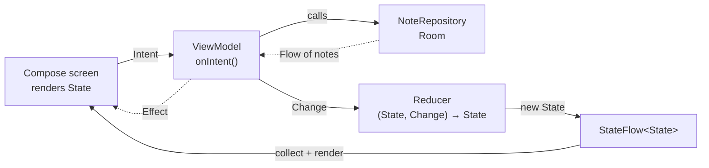

# QuickNote MVI

A simple offline notes app for Android, built with Kotlin, Jetpack Compose and the MVI (Model-View-Intent) pattern. Notes live in a local Room database on the device; there is no account and no backend.


## Features

- **Notes list:** all notes, newest edit first, with a title and a one-line preview.
- **Create and edit:** a title and a plain-text body that save automatically as you type.
- **Delete with Undo:** swipe a note away and bring it back from the snackbar.
- **Search:** filter notes by words in the title or body, ignoring case and accents.
- **Fully offline:** everything happens on the device.

## Architecture

Every screen follows the same one-way MVI loop. The MVI layer is written by hand, without an MVI library, so each part of the pattern is visible in the code.



Each screen has four types:

| Type | What it is |
| --- | --- |
| **State** | One immutable data class the screen renders, and nothing else |
| **Intent** | A sealed interface of user actions, sent through a single `onIntent()` function |
| **Change** | A sealed interface of state updates, produced by intents and by data from Room |
| **Effect** | One-off events such as navigation and snackbars, delivered once through a `Channel` |

The rules that keep the loop clear:

- **The reducer is pure.** `reduce(state, change)` returns a new State with no coroutines, database or Android types, so it is tested with plain JUnit.
- **Side effects live in the ViewModel.** Database calls run in `viewModelScope`, and their results come back as Changes.
- **Room is the source of truth.** Screens never read the database directly; the repository exposes a `Flow`, and every write updates the list on its own.
- **Route and Screen are split.** `NotesListRoute` owns the ViewModel and collects State and Effects; `NotesListScreen(state, onIntent)` is stateless, so previews and UI tests render it directly.

## Tech stack

| Area | Libraries |
| --- | --- |
| Language | Kotlin |
| UI | Jetpack Compose (via the Compose BOM), Material 3, Material icons |
| Navigation | Navigation Compose with type-safe routes (kotlinx.serialization) |
| Presentation | Hand-rolled MVI on AndroidX ViewModel, `StateFlow` and `Channel`; `lifecycle-runtime-compose` for `collectAsStateWithLifecycle` |
| Local database | Room, with its compiler run by KSP |
| Dependency injection | Hilt, with its compiler run by KSP, and `hilt-lifecycle-viewmodel-compose` for `hiltViewModel()` |
| Async | Kotlin coroutines and Flow |
| Testing | JUnit, Turbine, kotlinx-coroutines-test, Room testing, Compose UI tests |

Exact versions live in [`gradle/libs.versions.toml`](./gradle/libs.versions.toml).

## Project structure

```text
app/src/main/java/com/cphan/quicknotemvi/
├── ui/
│   ├── list/       NotesListRoute, NotesListScreen, NotesListViewModel, contract, reducer
│   ├── editor/     NoteEditorRoute, NoteEditorScreen, NoteEditorViewModel, contract, reducer
│   └── theme/      Material 3 theme
├── data/           Note model, NoteEntity, NoteDao, AppDatabase, NoteRepository
├── di/             Hilt modules
├── MainActivity.kt NavHost for the list and editor
└── NoteApplication.kt
```

## Getting started

### Prerequisites

- [Android Studio](https://developer.android.com/studio)
- JDK 25 (Gradle can download it for you)

### Clone and run

```bash
git clone https://github.com/<your-username>/QuickNoteMVI.git
cd QuickNoteMVI
```

Open the project in Android Studio and run the `app` configuration, or build from the command line:

```bash
./gradlew :app:assembleDebug
```

## Testing

```bash
# Reducers and ViewModels, on the JVM
./gradlew :app:testDebugUnitTest

# Room DAO and Compose UI tests, on a device or emulator
./gradlew :app:connectedDebugAndroidTest
```

## Development workflow

This project uses spec-driven development. Each feature has a spec with numbered requirements and Given/When/Then acceptance criteria:

1. **Spec:** agree the feature's spec before writing code.
2. **Tests first:** turn each acceptance criterion into a failing test named after its ID, for example `EDIT_AC3_editSurvivesProcessDeath`.
3. **Build:** write code until those tests pass.
4. **Verify:** every requirement maps to a passing test.
5. **Change control:** to change behaviour, update the spec first, then the tests, then the code.

| Feature | ID prefix |
| --- | --- |
| Notes list | `LIST` |
| Create and edit | `EDIT` |
| Delete | `DEL` |
| Search | `SRCH` |

## Contributing

Issues and pull requests are welcome. For a new feature or a behaviour change, start by opening an issue that describes the requirement and its acceptance criteria, so the spec can be agreed before any code is written.
